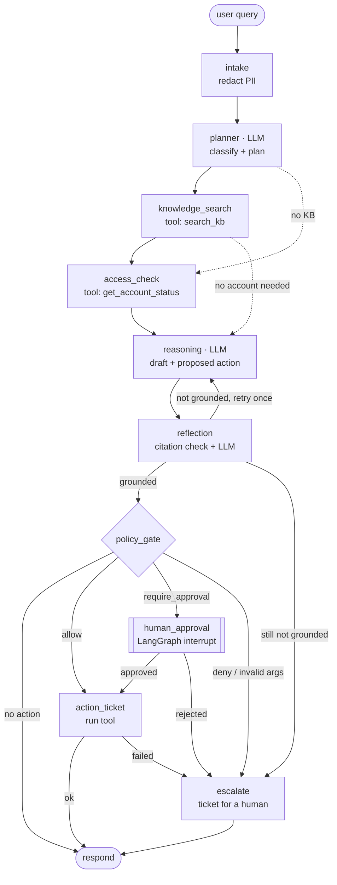

# IT Helpdesk — Multi-Agent System

A multi-agent IT helpdesk built on **LangGraph**. Its tools are policy-gated, it pauses for **human approval** before high-risk actions, it emits **OpenTelemetry** traces for every step, and it has an **evaluation harness** with regression detection. You can use it from a CLI or a Streamlit dashboard.

The design keeps the core loop simple so reviewers can follow execution: explicit nodes, one typed state object, and one path for every tool call.

| | |
|---|---|
| Orchestration | LangGraph `StateGraph`: planning, conditional routing, reflection, HITL interrupt |
| LLM | OpenAI `gpt-4o-mini` by default. Switch with `LLM_PROVIDER=anthropic` |
| Knowledge search | Chroma + OpenAI embeddings, hybrid semantic + keyword |
| Governance | YAML tool registry, AI registry, policy-as-code, Pydantic contracts, PII redaction |
| Observability | OpenTelemetry spans on every node, tool and LLM call, exported to JSONL/console |
| Evaluation | 50 frozen golden tickets; correctness, groundedness, tool use; baseline + regression check |
| Conversations | Multi-turn: agents see a bounded summary of earlier turns; conversations and pending approvals persist in SQLite |
| Interfaces | `helpdesk` CLI and a Streamlit dashboard (chat, approvals, traces, evals, registry) |

---

## Quickstart

Requires **Python 3.12** and an OpenAI API key.

```bash
python3.12 -m venv venv && source venv/bin/activate
pip install -r requirements-dev.txt && pip install -e .
cp .env.example .env               # first time only, it overwrites an existing .env
# edit .env: set OPENAI_API_KEY=sk-...
python scripts/prepare_data.py     # freezes the golden subset, builds the Chroma KB (8 docs)
helpdesk ui                        # dashboard at http://localhost:8501
```

### Things to try in the dashboard

| Do | Expect |
|---|---|
| *"How do I export my data to CSV?"* | Resolved from the KB, no action |
| Customer **CUST_02280** (locked) + *"My account is locked"* | ⏸️ Approval card for `reset_credentials` → Approve / Reject |
| *"Please refund the extra 900 dollars"* | Denied by policy rule `refund-limit` → escalated |
| Role **viewer** + a bug report | Denied by `role-permission` → escalated |
| Sidebar → **Send example** | Runs any of the 50 golden tickets |
| After an answer, ask a follow-up (*"it still doesn't work"*) | Caption shows *used 1 earlier turn(s)*; the reply builds on the earlier resolution |
| ➕ **New conversation**, then click an old one in the sidebar | Old conversation reopens, including a pending approval (⏸) you can still decide |
| Refresh the page | The current conversation reopens (its id is in the URL, `?c=…`) |
| 🔭 Traces tab | Span timeline / table for any session |
| 📊 Evaluation tab | Scores vs baseline, regression check, run an eval |

## Docker

One image serves the dashboard and the CLI. It runs as a non-root user, and no secrets are baked in: the key comes from the environment at runtime. On first start the KB index is built into the runtime volume.

```bash
docker compose up --build -d                     # dashboard at http://localhost:8080 (reads .env)
docker compose run --rm helpdesk query "How do I export my data?"
docker compose run --rm helpdesk eval --limit 5
docker compose run --rm helpdesk smoke           # 11 live scenarios inside the container
docker compose down                              # add -v to also delete the data volume
```

Without compose: `docker build -t it-helpdesk . && docker run --env-file .env -p 8080:8080 -v helpdesk-data:/var/lib/helpdesk it-helpdesk`.

Everything the app writes (KB index, sessions, traces, conversations, checkpoints) goes to `RUNTIME_DIR` (`/var/lib/helpdesk` in the image), so it survives container restarts. That includes pending approvals. The image listens on `$PORT` (default 8080) and has a health check on `/_stcore/health`.

## CLI

```bash
helpdesk query "My account is locked" --customer-id CUST_02280   # prompts for approval
helpdesk query "..." --approve | --reject | --role viewer | --no-trace
helpdesk query "It still fails" --customer-id CUST_02280 --conversation <conversation_id>   # follow-up turn
helpdesk query "My account is locked" --customer-id CUST_02280 --defer   # leave approval pending
helpdesk resume <session_id> --approve|--reject [--comment "..."]          # decide later, any process
helpdesk conversations                                                      # recent conversations, ⏸ = pending
helpdesk trace <session_id>          # span tree for a session (id is printed by `query`)
helpdesk eval                        # all 50 tickets vs baseline; exit code 1 on regression
helpdesk eval --limit 5 | --ticket TCKT_025902 | --split panel | --save-baseline
helpdesk list-agents | list-tools
helpdesk ui [--port 8501] [--host 0.0.0.0] [--headless]
```

## Tests

```bash
pytest                          # 129 unit/graph/UI tests, scripted fake LLM, no API calls (~5 s)
pytest -m integration           # live Chroma + OpenAI embedding check
python scripts/smoke_test.py    # 11 live end-to-end scenarios incl. prompt injection (~1 min)
ruff check .
```

---

## Architecture



Any node that raises or times out marks the run `failed`, and routing sends it to `escalate`: the fallback is always a human.

### Conversations & state

A **conversation** is an ordered list of **turns**, and each turn is one graph run (one session, one trace). That keeps evaluation, tracing and replay per-ticket while the chat feels continuous.

- **Context.** For a follow-up, the planner, reasoning and reflection agents get a summary of the last 3 completed turns: question, resolution, action, outcome and ticket/reference id, truncated to 300 chars per field. The summary is built from the already-redacted session records and only includes turns **for the same customer**, so one customer's data never leaks into another's context.
- **Persistence.** LangGraph checkpoints (`SqliteSaver`) and the conversation index live in `data/state/*.sqlite`. A pending approval survives a restart and can be resumed from another process (`helpdesk resume`) or from the dashboard. In production these would move to Postgres / Cloud SQL (or Firestore for the index); the stores are isolated classes for that reason.
- **Scope.** Eval and smoke runs use `track_conversation=False`, so they don't fill the conversation list. There is no login yet: every dashboard user sees all conversations (fine for a single-user demo; real users need auth + per-user scoping).

### Agents (AI registry: `config/agents.yaml`)

| Agent | Role | Allowed tools |
|---|---|---|
| planner | Classifies intent into 8 issue types, plans steps, decides KB/account lookups | — |
| knowledge_search | Hybrid search over KB resolution articles | `search_kb` |
| access_check | Mock account / SLA / MFA status from ticket metadata | `get_account_status` |
| reasoning | Drafts resolution, customer reply, cites articles, proposes one action | — |
| reflection | Deterministic citation check, then LLM groundedness review | — |
| action_ticket | Executes the approved action or creates a ticket | `create_ticket`, `reset_credentials`, `update_security_settings`, `issue_refund` |

### Every tool call takes one path

`ToolExecutor.execute()` → **policy** (allow / require_approval / deny) → **Pydantic input validation** → run with **per-tool timeout** and **retries** (3 attempts, exponential backoff, transient errors only) → **output validation** → `ToolResult`. Agents never call tool handlers directly.

The LLM chooses *which* action, but **tool arguments are built in code** from state, never free-form from the LLM.

## Governance & security

**Policy-as-code** (`config/policy.yaml`) is evaluated before every tool call. It checks, in order:

1. The tool is registered. Otherwise **deny**.
2. The tool is in the agent's `allowed_tools` (least privilege). Otherwise **deny**.
3. The tool is permitted for the requester's role (`viewer` / `user` / `admin`). Otherwise **deny**.
4. Then the rules, first match wins:

| Rule | Effect |
|---|---|
| `account-must-exist`: account-changing action without a verified account lookup | deny |
| `refund-limit`: refund > 500 | deny (even with approval) |
| `approval-required-tools`: tool flagged `approval_required` | **HITL** |
| `allow-low-medium-risk` | allow |
| *(no match)* | deny by default |

Further controls:

- **HITL.** The graph pauses with `interrupt()`, and the approver sees the tool, arguments, reason and policy rule. Malformed requests (e.g. a refund with no amount) are escalated *before* a human is asked.
- **Typed contracts.** Pydantic schemas with `extra="forbid"` for every tool input and output.
- **PII.** User input is redacted at intake (email, phone, card, SSN, IP, API keys, `password: …`), before any LLM call. Span attributes and session files are redacted again.
- **Data minimization.** Account data is only fetched for access, security and billing issues, whatever the LLM asks for.
- **Secrets.** Keys come from environment / `.env` (git-ignored). Only synthetic data is used.

## Observability

Every node (`agent.*`), LLM call (`llm.*`, with token counts) and tool call (`tool.*`, with policy decision, rule and attempts) is an OpenTelemetry span. Attributes include `session_id`, `agent_name`, `tool_name`, `latency_ms`, `decision`, `token_count` and errors.

One session is one trace, **including across a HITL pause**: resume re-attaches to the original root span.

Spans export to `data/traces/traces.jsonl` (read by `helpdesk trace` and the dashboard) and optionally to the console (`helpdesk --otel-console ...`). Adding an OTLP exporter for Jaeger/Tempo is one span processor in `telemetry.setup_tracing`.

Each session is also captured to `data/sessions/<session_id>.json`: messages, plan, draft, every tool request/response, policy decisions, approval and outcome.

## Evaluation

`helpdesk eval` runs each golden ticket's `initial_message` through the real graph, auto-approving HITL as `eval-auto`. It scores:

| Metric | How | Drift-proof? |
|---|---|---|
| correctness | LLM judge vs `resolution_summary` (1 / 0.5 / 0) | pinned model, temp 0, versioned prompt |
| groundedness | LLM judge: is the reply supported by the tool results? | same |
| tool_use | right action for the issue type + account lookup only when needed | deterministic |
| classification | planner issue type = golden issue type | deterministic |
| resolution_match | cited KB article's resolution = golden resolution | deterministic |
| latency p50/p95, tokens | from the run's spans | — |

A **regression** is flagged when a quality metric drops more than 0.05, when latency or tokens grow more than 50%, or when a ticket that passed in the baseline now fails. Config differences vs the baseline (model, judge prompt version, top-k) are reported so deltas aren't misread. Only `data/eval/baseline.json` is versioned.

**Current baseline** (50 tickets, `gpt-4o-mini`): correctness 1.00 · groundedness 0.95 · tool_use 1.00 · classification 1.00 · resolution_match 1.00 · p50 4.1 s · ~1,980 tokens per ticket · 0 errors.

**Regression demo:** `KB_TOP_K=1 helpdesk eval` → correctness and resolution_match drop, 7 tickets newly fail, exit code 1.

Caveats: the judge is the same small model as the agent, so correctness is generous; the deterministic metrics corroborate it. Billing tickets give no refund amount, so they are escalated by design (safety over score).

## Configuration (`.env`)

| Variable | Default | |
|---|---|---|
| `LLM_PROVIDER` | `openai` | or `anthropic` (set `ANTHROPIC_API_KEY` and an Anthropic `LLM_MODEL`) |
| `LLM_MODEL` / `JUDGE_MODEL` | `gpt-4o-mini` | agent model / eval judge model |
| `EMBEDDING_MODEL` | `text-embedding-3-small` | KB embeddings (OpenAI) |
| `OPENAI_BASE_URL` | `https://api.openai.com/v1` | |
| `OPENAI_API_KEY` | — | required |
| `KB_TOP_K` | `3` | KB results given to the reasoning agent |
| `RUNTIME_DIR` | `data/` | where the index, sessions, traces and SQLite state are written (`/var/lib/helpdesk` in Docker) |
| `PORT` | `8080` (Docker) | dashboard port inside the container |

## Project layout

```
config/            tools.yaml · agents.yaml · policy.yaml
data/              raw CSV · golden_subset.json · accounts.json · kb_articles.json · eval/baseline.json
                   (generated, git-ignored: chroma/ · sessions/ · traces/ · state/)
scripts/           prepare_data.py · smoke_test.py
docker/            entrypoint.sh (ui | smoke | any helpdesk subcommand)
Dockerfile · docker-compose.yml · .dockerignore
src/helpdesk/
  app.py           HelpdeskApp.start() / resume(): used by CLI, dashboard, eval
  graph.py         StateGraph wiring and routers
  state.py         shared typed state
  agents/          planner · knowledge · access · reasoning · reflection · governance · action · frontdesk
  tools/           schemas (Pydantic) · executor · kb · account · actions
  registry/        tool_registry · ai_registry
  policy/          engine · redaction
  eval/            runner · scorers · baseline
  telemetry.py     OTel setup, span helper, JSONL exporter
  session_store.py session capture (per turn, JSON)
  conversation_store.py conversations → turns index (SQLite)
  llm.py           provider factory + LLMClient protocol
  cli.py           click CLI
  ui/              dashboard (Streamlit) · views (pure data shaping)
tests/             116 tests; fakes.py holds the scripted LLM
```

## Design notes (for discussion)

- **Why LangGraph.** Explicit, auditable control flow (planning, routing, reflection, HITL interrupt + checkpointing) without hiding the loop. OTel is the vendor-neutral tracing standard, and the `LLMClient` protocol avoids provider lock-in.
- **Agent failure.** Per-node timeout (60 s), overall graph budget (180 s), SDK retries for LLM calls, tenacity retries for transient tool errors, and fallback to escalation. A circuit breaker is the next step for repeated provider failures.
- **Caching.** Safe to cache KB search by query hash with a TTL, and LLM responses in eval mode. Never cache HITL or state-changing actions. (Not implemented yet.)
- **State & concurrency.** Nodes return partial updates, and append-only fields use reducers, so there's no shared mutable state. Checkpoints are in SQLite (survives restarts, single node); for several instances use the Postgres checkpointer so any instance can resume any session.
- **Distributed.** Agents could become separate services (A2A or a queue), with a saga pattern for multi-step actions and event sourcing for audit. Trace context propagates via W3C headers, and `session_id` correlates across services.
- **AI gateway.** Rate limits, cost tracking, model routing and central auth. Here, the provider factory plays that role.
- **Cost.** Small model everywhere, short prompts, top-3 KB context, deterministic checks before LLM checks, judge tokens tracked separately.
- **Adding an agent.** Register it in `agents.yaml` (capabilities, allowed tools), add a node function, add one edge. Tools are added in `tools.yaml` + `schemas.py` with no code changes to the policy engine.

## Not yet implemented

Deterministic **replay** from captured sessions (capture is done), circuit breaker, KB/LLM caching, OTLP export, auth / per-user conversation scoping, CI and Cloud Run deployment.
